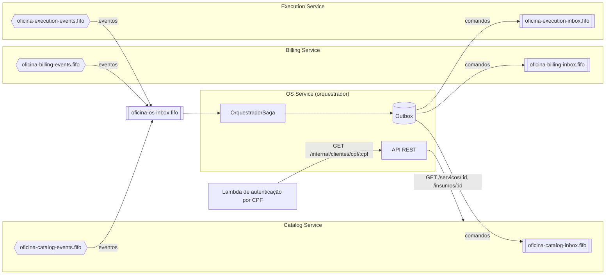
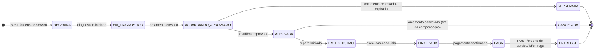
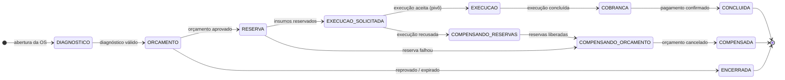

# tc-fase4-os — OS Service

[](https://sonarcloud.io/summary/new_code?id=Os-Desacoplados-Pos-Tech-SOAP-FIAP_tc-fase4-os)
[](https://sonarcloud.io/summary/new_code?id=Os-Desacoplados-Pos-Tech-SOAP-FIAP_tc-fase4-os)
[](https://sonarcloud.io/summary/new_code?id=Os-Desacoplados-Pos-Tech-SOAP-FIAP_tc-fase4-os)
[](https://sonarcloud.io/summary/new_code?id=Os-Desacoplados-Pos-Tech-SOAP-FIAP_tc-fase4-os)

Microsserviço do **atendimento e da ordem de serviço**. Cuida do login dos funcionários, dos cadastros de cliente e
veículo, da abertura da OS com itens precificados no Catalog e da consulta de status pelo cliente. Também é o
**orquestrador da saga** (process manager), que conduz a OS do diagnóstico até a entrega do veículo.

Stack: NestJS 10, TypeScript, PostgreSQL 16, Prisma 5, SQS FIFO (AWS SDK v3), Pino, OpenTelemetry, jest-cucumber.

## Arquitetura geral

O OS manda cada comando direto na fila de entrada do serviço dono e recebe todos os eventos pela própria fila de
entrada, `oficina-os-inbox.fifo`, que assina os tópicos de eventos dos outros três serviços (assinaturas criadas localmente por `local/localstack/init.sh` e, na AWS, pelo Terraform da infra na Etapa 8). Ele não tem tópico de
eventos próprio. A única chamada síncrona entre serviços da saga é a consulta de preço ao Catalog (REST).



Cada fila de entrada tem uma DLQ (`oficina-<serviço>-inbox-dlq.fifo`) com `maxReceiveCount = 3`.

## Saga

A saga é orquestrada: o `OrquestradorSaga` (`src/application/saga/orquestrador-saga.ts`) reage a cada evento numa
transação única. A sequência é: idempotência (`ProcessedMessage`) → trava da OS → leitura da OS e da saga → decisão →
gravação da OS, do histórico, da saga e dos comandos na outbox. O agregado `OrdemDeServico` guarda as regras de status;
a `SagaInstance` guarda só a etapa, o código e o motivo da compensação.

### Estados da OS

Só a saga e a entrega mudam o status. `REPROVADA`, `ENTREGUE` e `CANCELADA` são finais.



### Etapas da saga



`EXECUCAO`, `COBRANCA` e `CONCLUIDA` são pós-pivô. A etapa aparece em `GET /ordens-de-servico/:id` como `etapaSaga`.

### Reação a cada evento

Fora da condição, o evento é **ignorado**: nada é gravado além do `messageId` em `ProcessedMessage`, e sai um log
`warn` com `type`, `messageId`, `osId`, status e etapa.

| Evento | Condição | Efeito | Comandos enviados |
|---|---|---|---|
| `execution.diagnostico-iniciado.v1` | OS `RECEBIDA` ou `EM_DIAGNOSTICO` | OS → `EM_DIAGNOSTICO` (já em diagnóstico: sem mudança) | — |
| `execution.diagnostico-concluido.v1` | saga `DIAGNOSTICO` e OS `EM_DIAGNOSTICO` | orçamento inválido: histórico `Diagnóstico reaberto: <motivo>`; válido: saga → `ORCAMENTO` | inválido: `execution.reabrir-diagnostico.v1`; válido: `billing.gerar-orcamento.v1` (cliente + itens) |
| `billing.orcamento-enviado.v1` | saga `ORCAMENTO` e OS `EM_DIAGNOSTICO` ou `AGUARDANDO_APROVACAO` | OS → `AGUARDANDO_APROVACAO` com valor e validade (já aguardando: sem mudança) | — |
| `billing.orcamento-aprovado.v1` | saga `ORCAMENTO` e OS `AGUARDANDO_APROVACAO` | OS → `APROVADA`; saga → `RESERVA` | `catalog.reservar-insumos.v1` (só os insumos; pode ir vazio) |
| `billing.orcamento-reprovado.v1` / `billing.orcamento-expirado.v1` | saga `ORCAMENTO` e OS `AGUARDANDO_APROVACAO` | OS → `REPROVADA` com o motivo; saga → `ENCERRADA` | — |
| `catalog.insumos-reservados.v1` | saga `RESERVA` | saga → `EXECUCAO_SOLICITADA` | `execution.enfileirar-execucao.v1` (só os serviços) |
| `catalog.insumos-reservados.v1` (atrasado) | saga `ENCERRADA` ou `COMPENSADA` | nenhum (log `warn`) | `catalog.liberar-reservas.v1` |
| `catalog.reserva-insumos-falhou.v1` | saga `RESERVA` | saga → `COMPENSANDO_ORCAMENTO` com código e motivo | `billing.cancelar-orcamento.v1` |
| `execution.execucao-aceita.v1` | saga `EXECUCAO_SOLICITADA` | saga → `EXECUCAO` (**pivô**) | — |
| `execution.execucao-recusada.v1` | saga `EXECUCAO_SOLICITADA` | saga → `COMPENSANDO_RESERVAS` com código e motivo | `catalog.liberar-reservas.v1` |
| `catalog.reservas-liberadas.v1` | saga `COMPENSANDO_RESERVAS` | saga → `COMPENSANDO_ORCAMENTO` | `billing.cancelar-orcamento.v1` |
| `billing.orcamento-cancelado.v1` | saga `COMPENSANDO_ORCAMENTO` e OS `APROVADA` | OS → `CANCELADA` com o motivo técnico; saga → `COMPENSADA` | — |
| `execution.reparo-iniciado.v1` | saga `EXECUCAO` e OS `APROVADA` | OS → `EM_EXECUCAO` | — |
| `execution.execucao-concluida.v1` | saga `EXECUCAO` e OS `EM_EXECUCAO` | OS → `FINALIZADA`; saga → `COBRANCA` | `catalog.baixar-reservas.v1` e `billing.gerar-cobranca.v1` |
| `billing.cobranca-gerada.v1` | OS `FINALIZADA` | grava `linkPagamento` | — |
| `billing.pagamento-recusado.v1` | OS `FINALIZADA` | histórico `Pagamento recusado: <motivo>`; limpa `linkPagamento` | `billing.gerar-cobranca.v1` (novo `messageId`) |
| `billing.pagamento-confirmado.v1` | OS `FINALIZADA` e saga `COBRANCA` | OS → `PAGA`; saga → `CONCLUIDA` | — |
| `execution.servico-executado.v1`, `catalog.estoque-baixado.v1` | — | aceitos e descartados (a mensagem sai da fila) | — |

A abertura da OS (`POST /ordens-de-servico`) grava a OS `RECEBIDA`, a saga em `DIAGNOSTICO` e o comando
`execution.enfileirar-diagnostico.v1` na mesma transação. A entrega (`POST /ordens-de-servico/:id/entrega`) só
funciona com a OS `PAGA` e não envia comando.

### Pivô, compensações e eventos atrasados

- **Pivô:** `execucao-aceita`. Antes dele, as falhas são compensadas. Depois dele não há rollback, só retentativa: uma
  `execucao-recusada` que chegue na etapa `EXECUCAO` é ignorada, e a recusa do pagamento gera uma nova cobrança.
- **Compensação em ordem inversa, um passo por vez:**
  - falta de estoque (`reserva-insumos-falhou`): `cancelar-orcamento` → `orcamento-cancelado` → OS `CANCELADA`;
  - fila de execução cheia (`execucao-recusada`): `liberar-reservas` → `reservas-liberadas` → `cancelar-orcamento` →
    `orcamento-cancelado` → OS `CANCELADA`.

  A OS só fica `CANCELADA` com a última confirmação; até lá ela continua `APROVADA`.
- **Reserva atrasada:** se `insumos-reservados` chegar com a saga já encerrada **antes do pivô** (`ENCERRADA` ou
  `COMPENSADA`), o OS manda `liberar-reservas` para não deixar estoque preso. Em qualquer outra etapa (inclusive
  `CONCLUIDA` e as de compensação em andamento), o evento é ignorado.
- **Eventos repetidos sem mudança:** `diagnostico-iniciado` com a OS já `EM_DIAGNOSTICO` (reabertura) e
  `orcamento-enviado` com a OS já `AGUARDANDO_APROVACAO` não gravam OS nem saga e não geram `warn`. Só o `messageId` é
  registrado. A mesma mensagem (mesmo `messageId`) entregue de novo é descartada antes de qualquer leitura.
- **Motivo amigável ao cliente:** o `billing.cancelar-orcamento.v1` (cujo motivo vai no e-mail do cliente) leva um texto
  escolhido pelo código da falha, guardado em `SagaInstance.codigoCompensacao`
  (`src/application/saga/motivo-compensacao.ts`):

  | Código | Texto ao cliente |
  |---|---|
  | `ESTOQUE_INSUFICIENTE` (Catalog) | Não há estoque suficiente para as peças do orçamento |
  | `CAPACIDADE_ESGOTADA` (Execution) | A oficina está sem capacidade de execução no momento |
  | qualquer outro, ou código nulo | Não foi possível seguir com o serviço |

  O detalhe técnico (`motivoCompensacao`, ex.: `Execução recusada: Fila de execução cheia`) fica na saga e no
  histórico da OS cancelada.

## Catálogo de eventos

### Envelope e entrega

Todas as mensagens usam o envelope `{ messageId, type, occurredAt, correlationId, causationId?, payload }`:

- `correlationId` é o `osId` e também o `MessageGroupId` FIFO. Por isso a ordem é garantida por OS.
- `MessageDeduplicationId` é o `messageId`.
- Cada comando do OS leva como `causationId` o `messageId` do evento que o originou.
- O atributo de mensagem `type` repete o tipo; o `traceparent` segue como atributo quando há trace.

**Tolerant reader:** o tipo carrega a versão (`.v1`). O OS valida só os campos que lê (`valorTotal` e `validoAte` em
`orcamento-enviado`, `initPoint` em `cobranca-gerada`, `motivo` e `mensagem?` nas falhas) e ignora o resto do payload.
Envelope fora do contrato (JSON inválido, campo obrigatório ausente) ou tipo sem handler (inclusive outra versão)
falha e vai para a DLQ.

**Inbox:** long-poll de 20 s, em lotes de 10. Mensagem processada é apagada; com falha, ela fica na fila, volta após o
visibility timeout (30 s) e vai para a DLQ após 3 recebimentos. Depois de uma falha, as mensagens seguintes da mesma OS
no lote são puladas para não quebrar a ordem.

**Outbox:** os comandos são gravados na mesma transação do efeito e publicados por um worker (ciclo de 1 s). Um único
publicador é eleito por `pg_try_advisory_xact_lock`. A ordem é preservada por OS (`seq`). Uma falha de envio afeta só a
própria OS: incrementa `tentativas`, grava `ultimoErro` e a mensagem é tentada de novo no ciclo seguinte.

### Comandos

| Comando | Dono (fila) | Payload | Enviado pelo OS quando |
|---|---|---|---|
| `execution.enfileirar-diagnostico.v1` | Execution (`oficina-execution-inbox.fifo`) | `{ numeroOs }` | abertura da OS |
| `execution.reabrir-diagnostico.v1` | Execution | `{}` | orçamento inválido no `diagnostico-concluido` |
| `execution.enfileirar-execucao.v1` | Execution | `{ itens: [{ itemId, servicoId, descricao }] }` | insumos reservados (pivô) |
| `billing.gerar-orcamento.v1` | Billing (`oficina-billing-inbox.fifo`) | `{ numeroOs, cliente: { nome, email }, itens: [{ itemId, tipo, referenciaId, descricao, quantidade, valorUnitario }] }` | diagnóstico válido |
| `billing.cancelar-orcamento.v1` | Billing | `{ motivo }` (texto ao cliente) | compensação |
| `billing.gerar-cobranca.v1` | Billing | `{}` | execução concluída; pagamento recusado |
| `catalog.reservar-insumos.v1` | Catalog (`oficina-catalog-inbox.fifo`) | `{ itens: [{ insumoId, quantidade }] }` | orçamento aprovado |
| `catalog.liberar-reservas.v1` | Catalog | `{}` | execução recusada; reserva atrasada |
| `catalog.baixar-reservas.v1` | Catalog | `{}` | execução concluída |

Valores monetários vão como `number` JSON.

### Eventos (todos consumidos pelo OS)

| Evento | Dono (tópico) | Payload |
|---|---|---|
| `execution.diagnostico-iniciado.v1` | Execution (`oficina-execution-events.fifo`) | `{ osId, mecanicoId }` |
| `execution.diagnostico-concluido.v1` | Execution | `{ osId }` |
| `execution.execucao-aceita.v1` | Execution | `{ osId }` |
| `execution.execucao-recusada.v1` | Execution | `{ osId, motivo, mensagem }`; `motivo` ∈ `CAPACIDADE_ESGOTADA`, `ORDEM_NAO_ENCONTRADA`, `ORDEM_EM_ESTADO_INVALIDO` |
| `execution.reparo-iniciado.v1` | Execution | `{ osId, mecanicoId }` |
| `execution.servico-executado.v1` | Execution | `{ osId, itemId, servicoId, minutos }` |
| `execution.execucao-concluida.v1` | Execution | `{ osId, minutos }` |
| `catalog.insumos-reservados.v1` | Catalog (`oficina-catalog-events.fifo`) | `{ osId, reservaId, itens: [{ insumoId, quantidade }] }` |
| `catalog.reserva-insumos-falhou.v1` | Catalog | `{ osId, motivo, mensagem }`; `motivo` = código do erro de domínio (ex.: `ESTOQUE_INSUFICIENTE`, `INSUMO_NAO_ENCONTRADO`) |
| `catalog.reservas-liberadas.v1` | Catalog | `{ osId }` |
| `catalog.estoque-baixado.v1` | Catalog | `{ osId, itens: [{ insumoId, quantidade }] }` |
| `billing.orcamento-enviado.v1` | Billing (`oficina-billing-events.fifo`) | `{ osId, orcamentoId, numeroOs, valorTotal, validoAte }` |
| `billing.orcamento-aprovado.v1` | Billing | `{ osId, orcamentoId }` |
| `billing.orcamento-reprovado.v1` | Billing | `{ osId, orcamentoId }` |
| `billing.orcamento-expirado.v1` | Billing | `{ osId, orcamentoId }` |
| `billing.orcamento-cancelado.v1` | Billing | `{ osId }` |
| `billing.cobranca-gerada.v1` | Billing | `{ osId, cobrancaId, valor, initPoint }` |
| `billing.pagamento-confirmado.v1` | Billing | `{ osId, cobrancaId, mpPaymentId, valor }` |
| `billing.pagamento-recusado.v1` | Billing | `{ osId, cobrancaId, mpPaymentId, motivo }` |

### Limitação conhecida: DLQ

A mensagem que esgota os 3 recebimentos vai para `oficina-os-inbox-dlq.fifo` e fica lá. Este serviço não lê a DLQ, não
reprocessa e não emite alerta. Também não há timeout de etapa: a saga dessa OS para na etapa em que estava até alguém
intervir manualmente (redrive da DLQ para a fila de entrada).

- Como a transação que falhou foi desfeita, o `messageId` não ficou em `ProcessedMessage`. O redrive reprocessa a
  mensagem normalmente.
- Enquanto a mensagem é retentada, o FIFO segura as seguintes da mesma OS. Depois que ela vai para a DLQ, as próximas
  passam. As que dependiam da etapa perdida chegam fora de etapa e são **ignoradas**, com o `messageId` registrado. O
  redrive tardio da mensagem da DLQ não as reaplica; nesse caso elas precisam ser reenviadas com `messageId` novo.

## Rotas

Prefixo `/api/os`; Swagger em `/api/os/docs`. As rotas usam JWT (HS256) com claims `sub` e `perfil`. O token vem do
login do OS (funcionários) ou da Lambda de CPF (perfil `CLIENTE`, `sub` = id do cliente).

| Rota | Descrição | Acesso |
|---|---|---|
| `POST /auth/login` | Autentica funcionário e devolve `accessToken` | público |
| `POST /auth/registrar` | Registra usuário (funcionário) | ADMINISTRADOR |
| `POST /clientes`, `GET /clientes`, `GET /clientes/:id`, `GET /clientes/documento/:documento`, `PUT /clientes/:id` | Cadastro de clientes (CPF/CNPJ) | ATENDENTE, ADMINISTRADOR |
| `POST /veiculos`, `GET /veiculos?clienteId=`, `GET /veiculos/:id`, `GET /veiculos/placa/:placa`, `PUT /veiculos/:id` | Cadastro de veículos | ATENDENTE, ADMINISTRADOR |
| `POST /ordens-de-servico` | Corpo `{ clienteId, veiculoId, observacoes? }`; abre a OS e inicia a saga | ATENDENTE, ADMINISTRADOR |
| `GET /ordens-de-servico?status=` | Lista as OS (mais recentes primeiro) | ATENDENTE, MECANICO, ADMINISTRADOR |
| `GET /ordens-de-servico/numero/:numero` | OS pelo número | ATENDENTE, MECANICO, ADMINISTRADOR |
| `GET /ordens-de-servico/:id` | OS com itens, orçamento, link de pagamento e etapa da saga | ATENDENTE, MECANICO, ADMINISTRADOR |
| `GET /ordens-de-servico/:id/historico` | Histórico de status | ATENDENTE, MECANICO, ADMINISTRADOR |
| `POST /ordens-de-servico/:id/itens` | Corpo `{ tipo: SERVICO \| INSUMO, referenciaId, quantidade }`; preço vem do Catalog | ATENDENTE, MECANICO, ADMINISTRADOR |
| `POST /ordens-de-servico/:id/entrega` | Entrega o veículo (só com a OS `PAGA`) | ATENDENTE, ADMINISTRADOR |
| `GET /publico/os/:numero/status` | `numero`, `status`, `valorTotal`, `atualizadoEm` de uma OS do próprio cliente | CLIENTE |
| `GET /internal/clientes/cpf/:cpf` | `{ id, nome, cpf }` para a Lambda de autenticação; **fora do Swagger** | header `X-Internal-Token` |
| `GET /health` | Liveness | público |

### Erros

Corpo padronizado com `statusCode`, `error`, `message` (e `code` nos erros de negócio).

| Causa | Status |
|---|---|
| Validação de entrada, UUID inválido, número de OS fora de 1..2147483647 | 400 |
| Credenciais ou token inválidos; perfil sem acesso | 401; 403 |
| Recurso inexistente; OS de outro cliente na rota pública | 404 |
| Conflito (registro duplicado, concorrência de versão) | 409 |
| Regra de negócio (`DomainError`, ex.: veículo de outro cliente, item fora do diagnóstico, entrega sem pagamento) | 422 |
| Catalog fora do ar, com timeout ou resposta fora do contrato | 503 |

## Decisões

- **Sem tópico SNS próprio:** nenhum serviço consome eventos do OS. Ele só envia comandos, direto na fila de entrada
  do dono (`destino` obrigatório na outbox).
- **Orçamento validado no `diagnostico-concluido`:** antes de pedir o orçamento ao Billing, o OS confere que há ao
  menos um item, ao menos um **serviço**, total maior que zero e total até 99.999.999,99. Se não passar, o diagnóstico
  volta para o mecânico (`reabrir-diagnostico`) com o motivo no histórico. Um orçamento inválido seria recusado pelo
  Billing, iria para a DLQ e travaria a OS.
- **Compensação sequencial:** cada desfazer espera a confirmação do anterior (reservas, depois orçamento). A OS só é
  cancelada quando tudo foi desfeito.
- **Eventos fora de etapa ignorados:** evento atrasado, duplicado com outro `messageId` ou fora de ordem não muda nada
  e não volta para a fila. Só fica registrado e logado. A exceção é a reserva atrasada antes do pivô, que é liberada.
- **Pagamento recusado gera nova cobrança:** depois do pivô não se desfaz o serviço. A recusa limpa o link, registra
  o motivo e pede outro link de pagamento ao Billing.
- **Trava por OS:** cada evento da saga e as rotas que alteram uma OS existente (inclusão de item e entrega) rodam numa
  transação com `pg_advisory_xact_lock` da OS. Além disso, OS e saga têm `versao` (lock otimista: versão divergente → 409 ou
  retentativa da mensagem). Assim, um item incluído pelo mecânico não corre com o `diagnostico-concluido`.
- **Catalog via REST:** `POST /ordens-de-servico/:id/itens` consulta `GET /servicos/:id` ou `GET /insumos/:id`
  repassando o JWT do usuário, com timeout de `CATALOG_TIMEOUT_MS` (padrão 3 s).
  - Item inexistente → 404; serviço inativo → 422; Catalog fora do ar, com timeout ou resposta inesperada → 503.
  - Nome e preço viram snapshot no item.
  - Itens só entram com a OS `EM_DIAGNOSTICO` e a saga em `DIAGNOSTICO`.
- **Status público só para o dono:** a rota do cliente exige perfil `CLIENTE`, e a OS precisa ser do cliente do token.
  OS de outro cliente responde 404, como se não existisse.
- **Número da OS por sequence:** o `numero` vem da sequence do Postgres (`OrdemDeServico_numero_seq`), nunca de
  `max + 1`. Assim, duas aberturas simultâneas não recebem o mesmo número.

## Rodando localmente

```bash
cp .env.example .env     # ajuste JWT_SECRET e INTERNAL_SERVICE_TOKEN
npm ci
docker compose up -d     # Postgres (5433) + LocalStack (SQS FIFO, filas criadas no boot)
npx prisma migrate deploy
npm run build && npx prisma db seed  # seed compilado (dist/infrastructure/database/seed.js)
npm run start:dev        # http://localhost:3001/api/os/docs
```

O `docker-compose.yml` sobe só as dependências do OS; o compose com os quatro serviços fica em `local/`.
O Postgres cria também o banco `os_test` (usado pelos testes). O script `docker/localstack/init-os.sh` cria as filas de
entrada de OS, Catalog, Billing e Execution, cada uma com sua DLQ. As dos outros serviços existem aqui só para o teste
isolado do OS.

### Fluxo completo (4 serviços)

Para subir OS, Catalog, Execution e Billing juntos, com LocalStack e smoke automatizado da saga, veja
[`local/README.md`](local/README.md).

### Seed (dados fixos de desenvolvimento)

| Registro | Id | Dados |
|---|---|---|
| Administrador | `0a000000-0000-4000-8000-000000000001` | `admin@oficina.local` / `admin123` |
| Atendente | `0a000000-0000-4000-8000-000000000002` | `atendente@oficina.local` / `senha123` |
| Mecânico | `0a000000-0000-4000-8000-000000000003` | `mecanico@oficina.local` / `senha123` |
| Cliente | `0c000000-0000-4000-8000-000000000001` | Ana Souza, CPF `52998224725` |
| Veículo | `0d000000-0000-4000-8000-000000000001` | `BRA2E19`, Volkswagen Polo 2021 |

As senhas acima são os padrões locais. Elas podem ser trocadas por `SEED_SENHA_ADMIN` e `SEED_SENHA_PADRAO` e são
obrigatórias com `NODE_ENV=production`.

### Teste local com LocalStack

Com o serviço no ar e a mensageria ligada (credenciais fictícias `test`/`test` do `.env.example`):

1. Faça login com o atendente do seed e abra uma OS para o cliente e o veículo do seed.
2. Leia a fila do Execution:
   `docker compose exec -T localstack awslocal sqs receive-message --queue-url http://localhost:4566/000000000000/oficina-execution-inbox.fifo --message-attribute-names All`.
   Deve chegar `execution.enfileirar-diagnostico.v1` com `MessageGroupId` = id da OS.
3. Publique um `execution.diagnostico-iniciado.v1` (envelope completo, `--message-group-id` = id da OS) em
   `oficina-os-inbox.fifo`. A OS passa a `EM_DIAGNOSTICO` com a saga em `DIAGNOSTICO`.
4. Um `type` desconhecido gera `Falha ao processar mensagem` no log e, após 3 recebimentos (cerca de 90 s), aparece em
   `oficina-os-inbox-dlq.fifo`.

### Variáveis de ambiente

| Variável | Obrigatória | Padrão | Descrição |
|---|---|---|---|
| `PORT` | não | `3000` | Porta HTTP (local: `3001`) |
| `NODE_ENV` | não | — | `development` liga o `pino-pretty` |
| `DATABASE_URL` | sim | — | Conexão PostgreSQL |
| `JWT_SECRET` | sim | — | Segredo HS256 compartilhado entre os serviços |
| `JWT_EXPIRES_IN` | não | `8h` | Validade do token de login |
| `INTERNAL_SERVICE_TOKEN` | sim | — | Segredo do header `X-Internal-Token` (mínimo 16 caracteres) |
| `CATALOG_BASE_URL` | sim | — | Base da API do Catalog, com o prefixo (ex.: `http://localhost:3002/api/catalog`) |
| `CATALOG_TIMEOUT_MS` | não | `3000` | Timeout da consulta ao Catalog (inteiro ≥ 1) |
| `MESSAGING_ENABLED` | não | ligado | `false` desliga inbox e outbox |
| `AWS_REGION` | não | `us-east-1` | Região |
| `AWS_ENDPOINT_URL` | não | — | Só em dev (LocalStack) |
| `AWS_ACCESS_KEY_ID`, `AWS_SECRET_ACCESS_KEY` | não | — | Credenciais fictícias do LocalStack |
| `INBOX_QUEUE_URL` | com mensageria ligada | — | URL da fila FIFO de entrada do OS |
| `CATALOG_COMMANDS_QUEUE_URL` | com mensageria ligada | — | Fila de entrada do Catalog |
| `BILLING_COMMANDS_QUEUE_URL` | com mensageria ligada | — | Fila de entrada do Billing |
| `EXECUTION_COMMANDS_QUEUE_URL` | com mensageria ligada | — | Fila de entrada do Execution |
| `OTEL_EXPORTER_OTLP_ENDPOINT` | não | — | Observabilidade (vazio = desligado) |
| `OTEL_SERVICE_NAME` | não | `tc-fase4-os` | Nome do serviço nos traces |

A validação (`src/config/env.validation.ts`) roda no boot e falha com a lista de variáveis ausentes ou inválidas.

## Testes e qualidade

| Script | Escopo |
|---|---|
| `npm test` | Unitários (`src/**/*.spec.ts`): domínio, casos de uso e orquestrador com fakes em memória |
| `npm run test:int` | Integração com PostgreSQL real (`test/integration`): repositórios e versão, transação, trava por OS, outbox |
| `npm run test:e2e` | HTTP ponta a ponta (`test/e2e`): auth, cadastros, OS, rotas pública e interna, health |
| `npm run test:bdd` | BDD em português (`test/bdd/features/saga-da-os.feature`, jest-cucumber), 8 cenários da saga |
| `npm run test:cov` | Todos os projetos com cobertura; limite global mínimo de 80% nas quatro métricas |

O BDD sobe o app Nest real com o Postgres de teste. Os outros serviços são simulados: os eventos são despachados no
`MessageHandlerRegistry`, os comandos são lidos da tabela `Outbox` e o Catalog é um fake em memória. Cenários:

- fluxo feliz até a entrega;
- reprovação;
- expiração;
- diagnóstico sem serviço;
- falta de estoque;
- fila de execução cheia;
- pagamento recusado;
- mensagem entregue duas vezes.

Integração, e2e e BDD rodam no banco `os_test` do Postgres do compose (`docker compose up -d postgres`); as
migrações são aplicadas no `globalSetup`.

Cobertura atual (`npm run test:cov`): 69 suítes e 402 testes (350 unit, 24 integração, 20 e2e, 8 BDD).

| Métrica | Cobertura |
|---|---|
| Linhas | **98,78%** |
| Statements | 98,11% |
| Branches | 89,97% |
| Funções | 97,44% |

Qualidade: `npm run lint:ci` (sem warnings) e `npm run build`.

## CI/CD

O workflow `.github/workflows/ci.yml` (job `ci`) roda, em ordem:

1. Postgres 16 como serviço;
2. `prisma generate`;
3. lint;
4. build;
5. testes com cobertura (relatório publicado como artefato);
6. build da imagem Docker (`docker/Dockerfile`);
7. análise SonarCloud.

`ci` e `SonarCloud Code Analysis` são checks obrigatórios para merge na `main` (ruleset `protect-main`).
